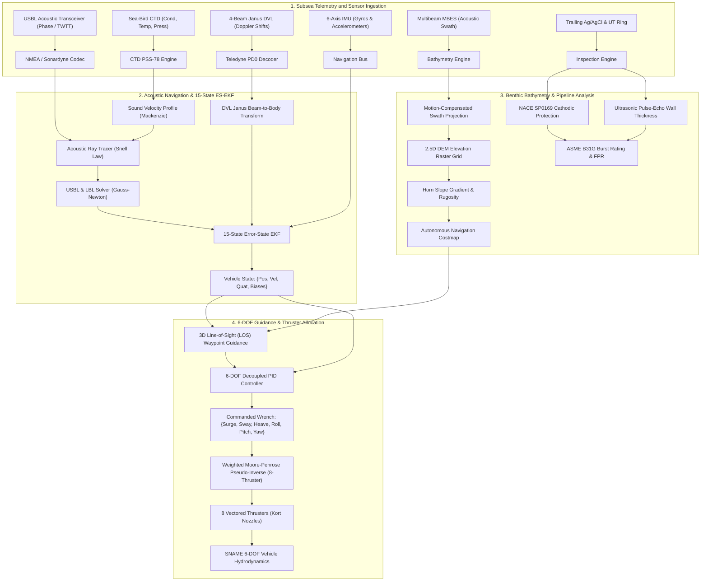

# Moonpool Architecture Specification

## 1. Executive Summary

Moonpool is an autonomous subsea intervention executive, acoustic navigation engine, and pipeline integrity inspection system. Built natively in OpenEuphoria v4.1 with an ISO C17 hardware fastpath acceleration kernel, Moonpool solves the complete cyber-physical stack of deepwater robotic operations:

1. **Stratified Acoustic Navigation**: Ray-traced sound velocity profiling (Mackenzie and Del Grosso formulations), Snell's law circular arc layer integration, Ultra-Short Baseline (USBL) phase interferometry, and Long Baseline (LBL) Gauss-Newton multilateration.
2. **Sensor Fusion and Kinematics**: 15-state Error-State Extended Kalman Filter (ES-EKF) fusing strapdown inertial mechanization, 4-beam Janus Doppler Velocity Log (DVL) bottom-track velocities, piezoresistive oceanographic depth sensors, and acoustic fixes.
3. **Benthic Bathymetry and Terrain Costmaps**: Multibeam Echo Sounder (MBES) motion-compensated swath projection, 2.5D Digital Elevation Model (DEM) spatial binning, Horn's finite-difference slope gradients, and autonomous hazard costmaps.
4. **Pipeline Structural Inspection**: Subsea pipeline cathodic protection (CP) electric field potential mapping (NACE SP0169), sacrificial anode electrochemical depletion modeling, multi-channel ultrasonic pulse-echo thickness scanning, and ASME B31G / Modified RSTRENG burst pressure rating.
5. **6-DOF Hydrodynamic Propulsion**: SNAME 1950 equations of motion, added mass, quadratic damping, metacentric restoring moments, and 8-thruster overactuated weighted Moore-Penrose pseudo-inverse allocation with active thruster fault-tolerance.

---

## 2. System Architecture Topology

The diagram below illustrates the end-to-end data flow between sensors, acoustic arrays, state estimation filters, thruster allocation, and pipeline inspection processors:

---

## 3. Coordinate Systems and Spatial Transformations

Moonpool rigorously defines coordinate transformations across five primary reference frames:

1. **Earth-Centered Earth-Fixed (ECEF)**: Cartesian system $(X, Y, Z)$ rotating with the Earth.
2. **Geodetic Frame**: Latitude ($\phi$), Longitude ($\lambda$), and Height ($h$) referenced to the WGS-84 reference ellipsoid ($a = 6378137.0\text{ m}, f = 1/298.257223563$).
3. **Local North-East-Down (NED)**: Local tangent plane navigation frame with origin fixed at mothership moonpool surface datum.
4. **Vehicle Body-Fixed Frame**: Origin at vehicle center of buoyancy. Positive $x$ points forward (Surge), positive $y$ points starboard (Sway), positive $z$ points downward (Heave).
5. **Sensor Mounting Frames**: Transducer-specific coordinate systems transformed via calibrated lever-arm offsets $l_b \in \mathbb{R}^3$.

Vector mapping from vehicle body coordinates $v_b$ to navigation frame $v_n$ is performed via the unit attitude quaternion $q = [w, x, y, z]^T$:

$$R_b^n(q) = \begin{bmatrix}
1 - 2(y^2 + z^2) & 2(xy - wz) & 2(xz + wy) \\
2(xy + wz) & 1 - 2(x^2 + z^2) & 2(yz - wx) \\
2(xz - wy) & 2(yz + wx) & 1 - 2(x^2 + y^2)
\end{bmatrix}$$

---

## 4. Snell's Law Stratified Acoustic Ray Tracing

In seawater, sound speed varies significantly with temperature, salinity, and depth. Ray propagation follows Snell's Law:

$$p = \frac{\cos\theta(z)}{c(z)} = \text{constant}$$

where $\theta(z)$ is the grazing angle relative to horizontal, and $c(z)$ is the sound speed computed via Mackenzie (1981):

$$c(T, S, D) = 1448.96 + 4.591 T - 5.304 \times 10^{-2} T^2 + 2.374 \times 10^{-4} T^3 + 1.340(S - 35) + 1.630 \times 10^{-2} D + 1.675 \times 10^{-7} D^2 - 1.025 \times 10^{-2} T (S - 35) - 7.139 \times 10^{-13} T D^3$$

Across stratified layers with constant vertical gradient $g = \frac{c_{out} - c_{in}}{\Delta z}$, acoustic rays travel along circular arcs with radius:

$$R = \frac{1}{|g \cdot p|}$$

Horizontal displacement across layer:

$$\Delta x = \frac{\sin\theta_{in} - \sin\theta_{out}}{g \cdot p}$$

Travel time across layer:

$$\Delta t = \frac{1}{|g|} \ln\left( \frac{c_{out}}{c_{in}} \frac{1 + \sin\theta_{in}}{1 + \sin\theta_{out}} \right)$$

---

## 5. 15-State Error-State Extended Kalman Filter (ES-EKF)

The navigation filter tracks vehicle position, velocity, and attitude by separating high-frequency nominal strapdown integration from low-frequency error covariance propagation.

### State Vectors
- **Nominal State** ($16$ elements): $x = [p_n^T, v_n^T, q^T, b_a^T, b_g^T]^T$
- **Error State** ($15$ elements): $\delta x = [\delta p^T, \delta v^T, \delta \theta^T, \delta b_a^T, \delta b_g^T]^T \in \mathbb{R}^{15}$

### Continuous Error Kinematics
$$\dot{\delta p} = \delta v$$
$$\dot{\delta v} = -R_b^n(q) [a_{meas} - b_a]_\times \delta \theta - R_b^n(q) \delta b_a$$
$$\dot{\delta \theta} = -[\omega_{meas} - b_g]_\times \delta \theta - \delta b_g$$
$$\dot{\delta b_a} = w_{ba}, \quad \dot{\delta b_g} = w_{bg}$$

### Discrete Propagation and Covariance
$$\Phi = I_{15} + F \Delta t$$
$$P_{k+1|k} = \Phi P_k \Phi^T + Q \Delta t$$

Measurement updates (DVL velocity, USBL position, pressure depth) use Joseph-form stabilized updates:

$$K = P H^T (H P H^T + R)^{-1}$$
$$P_{k|k} = (I - K H) P_{k+1|k} (I - K H)^T + K R K^T$$

The estimated error vector $\delta x$ is injected into the nominal quaternion via multiplicative correction:

$$q \leftarrow q \otimes \begin{bmatrix} 1 \\ \frac{1}{2}\delta\theta \end{bmatrix}$$

---

## 6. Overactuated 8-Thruster Allocation

The vehicle incorporates four horizontal vectored thrusters mounted at 45 degree angles and four vertical corner thrusters. The geometric mapping matrix $B \in \mathbb{R}^{6 \times 8}$ relates individual thruster forces $u = [f_1, \dots, f_8]^T$ to the generalized 6-DOF wrench $\tau = [X, Y, Z, K, M, N]^T$:

$$\tau = B \cdot u$$

Force allocation is resolved via weighted Moore-Penrose pseudo-inverse with Tikhonov damping:

$$u = W^{-1} B^T \left( B W^{-1} B^T + \lambda^2 I_6 \right)^{-1} \tau_{cmd}$$

The diagonal weighting matrix $W \in \mathbb{R}^{8 \times 8}$ encodes individual thruster health. If a thruster suffers motor or inverter failure ($W_{ii} = 0$), the allocation automatically redistributes loads to the remaining operational thrusters without vehicle loss of control.
